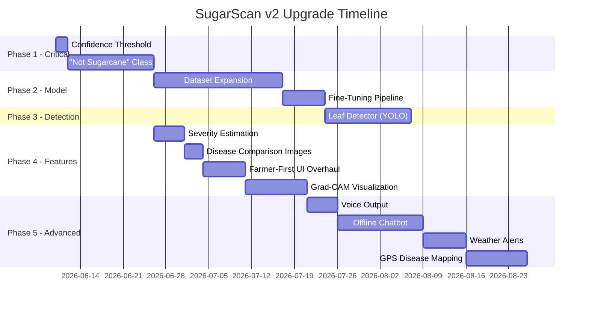

# SugarScan v2 — Complete Upgrade Plan

> Comprehensive plan to transform SugarScan from a conference demo into a production-grade agricultural tool.

---

## Current State Assessment

Your current codebase is well-structured:

| Component | File | Status |
|-----------|------|--------|
| Classifier | [classifier.dart](file:///c:/Users/ASUS/Desktop/yt_AI_copiolt%20(3)/lib/models/classifier.dart) | EfficientNetB0, 5 classes, TFLite, 224×224 input |
| Disease Data | [disease_data.dart](file:///c:/Users/ASUS/Desktop/yt_AI_copiolt%20(3)/lib/models/disease_data.dart) | Rich EN/HI/MR content for 5 diseases |
| Result Screen | [result_screen.dart](file:///c:/Users/ASUS/Desktop/yt_AI_copiolt%20(3)/lib/screens/result_screen.dart) | Confidence gauge, probabilities, disease details |
| Home Screen | [home_screen.dart](file:///c:/Users/ASUS/Desktop/yt_AI_copiolt%20(3)/lib/screens/home_screen.dart) | Stats, risk summary, scan buttons |
| Language | [language_service.dart](file:///c:/Users/ASUS/Desktop/yt_AI_copiolt%20(3)/lib/services/language_service.dart) | EN/HI/MR with reactive updates |
| Risk Data | [risk_data.dart](file:///c:/Users/ASUS/Desktop/yt_AI_copiolt%20(3)/lib/models/risk_data.dart) | Monthly risk calendar, preventive actions |
| Model | [final_model_1.tflite](file:///c:/Users/ASUS/Desktop/yt_AI_copiolt%20(3)/assets/model/final_model_1.tflite) | ~10MB TFLite, 5-class output |
| Labels | [labels.txt](file:///c:/Users/ASUS/Desktop/yt_AI_copiolt%20(3)/assets/model/labels.txt) | Healthy, Mosaic, RedRot, Rust, Yellow |

**Key Strengths**: Offline-first, trilingual, farmer-friendly language, seasonal risk calendar, farm journal  
**Critical Weakness**: No out-of-distribution rejection — any image gets classified as one of 5 diseases

---

## Phased Upgrade Plan



---

## Phase 1: Out-of-Distribution Rejection (HIGHEST PRIORITY)

> [!CAUTION]
> This is the #1 priority. Without this, your app will confidently tell a farmer that a photo of their face has "Rust Disease at 91%". This destroys trust instantly.

### Fix 1A: Confidence Threshold (2 days — FREE)

**What**: Add a minimum confidence check before showing results.

**Current flow** in [result_screen.dart](file:///c:/Users/ASUS/Desktop/yt_AI_copiolt%20(3)/lib/screens/result_screen.dart):
```
Image → Model → Show top prediction (always)
```

**New flow**:
```
Image → Model → Check confidence
  ├── ≥ 70%  → Show disease result normally
  ├── 50-69% → Show result with WARNING: "Low confidence — retake image"
  └── < 50%  → Show: "Unable to identify. Please ensure this is a sugarcane leaf."
```

**Files to modify**:

#### [MODIFY] [classifier.dart](file:///c:/Users/ASUS/Desktop/yt_AI_copiolt%20(3)/lib/models/classifier.dart)
- Add `confidenceLevel` enum to `ClassifierResult` (HIGH / LOW / REJECTED)
- Add threshold constants: `HIGH_CONFIDENCE = 0.70`, `MIN_CONFIDENCE = 0.50`

#### [MODIFY] [result_screen.dart](file:///c:/Users/ASUS/Desktop/yt_AI_copiolt%20(3)/lib/screens/result_screen.dart)
- Add new `_buildLowConfidenceWarning()` widget showing amber warning banner
- Add new `_buildRejectedResult()` widget showing "Image not recognized" screen
- Modify `_buildResult()` to check confidence level before rendering

#### [MODIFY] [language_service.dart](file:///c:/Users/ASUS/Desktop/yt_AI_copiolt%20(3)/lib/services/language_service.dart)
- Add translated strings: `lowConfidenceWarning`, `imageNotRecognized`, `retakePhoto`, etc.

**Cost**: ₹0 — Pure code change  
**Difficulty**: Easy  
**Impact**: HIGH — Prevents embarrassing wrong predictions on non-leaf images

---

### Fix 1B: "Not Sugarcane" Rejection Class (2 weeks — FREE to ₹500)

**What**: Retrain the model with a 6th class: `NotSugarcane`

**Training Data for "Not Sugarcane" class** (need ~1000-2000 images):

| Category | Source | Count | Cost |
|----------|--------|-------|------|
| Human faces | [UTKFace dataset](https://susanqq.github.io/UTKFace/) | 200 | Free |
| Hands | COCO dataset crops | 200 | Free |
| Soil/backgrounds | Field photography | 200 | Free (take yourself) |
| Other crops (rice, wheat, cotton leaves) | PlantVillage dataset | 200 | Free |
| Vehicles/buildings | ImageNet subsets | 100 | Free |
| Random objects (phones, tools, shoes) | COCO / Open Images | 100 | Free |
| Other plant leaves (non-sugarcane) | iNaturalist | 200 | Free |

**Training approach**:
```python
# Updated labels
classes = ['Healthy', 'Mosaic', 'RedRot', 'Rust', 'Yellow', 'NotSugarcane']

# Same EfficientNetB0 architecture, just add 1 more output neuron
base_model = EfficientNetB0(weights='imagenet', include_top=False, input_shape=(224, 224, 3))
x = GlobalAveragePooling2D()(base_model.output)
x = Dense(256, activation='relu')(x)
x = Dropout(0.3)(x)
output = Dense(6, activation='softmax')(x)  # 6 classes now
```

**Files to modify**:

#### [NEW] `training/train_v2.py`
- Python training script with EfficientNetB0 + 6 classes
- Data augmentation, class weights for imbalanced "NotSugarcane" class

#### [MODIFY] [labels.txt](file:///c:/Users/ASUS/Desktop/yt_AI_copiolt%20(3)/assets/model/labels.txt)
- Add `NotSugarcane` as 6th line

#### [MODIFY] [classifier.dart](file:///c:/Users/ASUS/Desktop/yt_AI_copiolt%20(3)/lib/models/classifier.dart)
- Update `_numClasses` default to 6
- Add logic: if top prediction is `NotSugarcane`, return special result

#### [MODIFY] [result_screen.dart](file:///c:/Users/ASUS/Desktop/yt_AI_copiolt%20(3)/lib/screens/result_screen.dart)
- Add new `_buildNotSugarcaneResult()` widget with friendly message
- "This doesn't look like a sugarcane leaf. Please try again with a leaf photo."

#### [NEW] [disease_data.dart](file:///c:/Users/ASUS/Desktop/yt_AI_copiolt%20(3)/lib/models/disease_data.dart) (add entry)
- Add `NotSugarcane` entry with appropriate messaging in EN/HI/MR

**Cost**: ₹0 if you have a GPU (Google Colab free tier works) — ₹500 if you need Colab Pro for faster training  
**Hardware needed**: Google Colab (free T4 GPU is sufficient for EfficientNetB0)  
**Difficulty**: Medium  
**Impact**: CRITICAL — This is the single most important improvement

---

## Phase 2: Model Quality Improvements

### Fix 2A: Dataset Expansion (3 weeks — FREE to ₹2,000)

**What**: Collect more diverse training images to push accuracy from ~86% → 90%+

**Current dataset gaps** (likely):

| Gap | What to collect | How |
|-----|----------------|-----|
| Lighting variation | Morning, evening, cloudy, indoor | Visit fields at different times |
| Phone diversity | Low-res, Samsung, Redmi, Oppo cameras | Ask friends/farmers to contribute |
| Leaf age | Young, mature, old leaves | Collect across growth stages |
| Sugarcane varieties | Co 0238, CoLk 94184, Co 86032 | Visit different farms |
| Disease severity | Early, moderate, severe stages | Document progression |
| Background variation | In-hand, on soil, on table, in-field | Vary shooting conditions |

**Target dataset size per class**:
```
Current:  ~500-800 images per class (estimated)
Target:   1500-2000 images per class
```

**Data Augmentation Pipeline** (multiply existing data):
```python
train_datagen = ImageDataGenerator(
    rotation_range=30,
    width_shift_range=0.2,
    height_shift_range=0.2,
    shear_range=0.15,
    zoom_range=0.2,
    horizontal_flip=True,
    vertical_flip=True,
    brightness_range=[0.7, 1.3],
    channel_shift_range=30,
    fill_mode='reflect',
    preprocessing_function=preprocess_input
)
```

**Cost breakdown**:
- Field visits for data collection: ₹500-1000 (travel)
- Google Colab Pro (if needed): ₹500/month
- External datasets: FREE (PlantVillage, Kaggle sugarcane datasets)
- Annotation (if needed): ₹0 — folder-based classification, no bounding boxes

**Difficulty**: Time-consuming but straightforward  
**Impact**: HIGH — Data quality > model architecture

---

### Fix 2B: Better Fine-Tuning Pipeline (1 week — FREE)

**What**: Implement proper staged fine-tuning for maximum accuracy

```python
# ═══════════════════════════════════════════════
# STAGE 1: Train classification head only (5-10 epochs)
# ═══════════════════════════════════════════════
base_model.trainable = False

model.compile(
    optimizer=Adam(learning_rate=1e-3),
    loss='categorical_crossentropy',
    metrics=['accuracy']
)

model.fit(train_data, epochs=10, validation_data=val_data)

# ═══════════════════════════════════════════════
# STAGE 2: Unfreeze top 50 layers (15-20 epochs)
# ═══════════════════════════════════════════════
base_model.trainable = True
for layer in base_model.layers[:-50]:
    layer.trainable = False

model.compile(
    optimizer=Adam(learning_rate=1e-5),  # Much smaller LR!
    loss='categorical_crossentropy',
    metrics=['accuracy']
)

callbacks = [
    ReduceLROnPlateau(monitor='val_loss', factor=0.5, patience=3),
    EarlyStopping(monitor='val_loss', patience=7, restore_best_weights=True),
    ModelCheckpoint('best_model.keras', save_best_only=True),
]

model.fit(train_data, epochs=30, validation_data=val_data, callbacks=callbacks)

# ═══════════════════════════════════════════════
# STAGE 3: Convert to TFLite
# ═══════════════════════════════════════════════
converter = tf.lite.TFLiteConverter.from_keras_model(model)
converter.optimizations = [tf.lite.Optimize.DEFAULT]
tflite_model = converter.convert()
```

**Files to create**:

#### [NEW] `training/train_v2_staged.py`
- Complete training pipeline with 3 stages
- Confusion matrix generation
- Per-class accuracy reporting
- TFLite conversion built-in

#### [NEW] `training/evaluate.py`
- Test on held-out data
- Generate classification report
- Produce confusion matrix visualization

**Cost**: ₹0  
**Difficulty**: Medium  
**Impact**: HIGH — Can add 3-5% accuracy improvement

---

## Phase 3: Leaf Detection Pre-Filter

### Fix 3: YOLOv8n Leaf Detector (2 weeks — FREE to ₹1,000)

**What**: Before running disease classification, verify the image contains a sugarcane leaf

**Architecture**:
```
Image
  ↓
YOLOv8n Leaf Detector (TFLite, ~6MB)
  ├── Sugarcane leaf detected → Crop leaf region → Disease Classifier
  └── No leaf detected → "No sugarcane leaf found in image"
```

**Why YOLOv8n specifically**:
- YOLOv8**n** (nano) = smallest variant, only ~6MB as TFLite
- Runs in ~30-50ms on modern phones
- Can be trained on Google Colab free tier

**Training data needed**:
```
~500 images with bounding boxes around sugarcane leaves
Tools: LabelImg (free), Roboflow (free tier for <1000 images)
```

**Dataset sources**:
- Your existing sugarcane images (draw bounding boxes)
- Roboflow public sugarcane datasets
- Take 200-300 new photos with varied backgrounds

**Files to modify/create**:

#### [NEW] `assets/model/leaf_detector.tflite`
- YOLOv8n model converted to TFLite

#### [NEW] `lib/models/leaf_detector.dart`
- TFLite-based leaf detection service
- Returns: `{detected: bool, bbox: Rect, confidence: double}`

#### [MODIFY] [classifier.dart](file:///c:/Users/ASUS/Desktop/yt_AI_copiolt%20(3)/lib/models/classifier.dart)
- Add optional pre-filtering step before disease classification
- Crop image to detected leaf bounding box before classifying

#### [MODIFY] [result_screen.dart](file:///c:/Users/ASUS/Desktop/yt_AI_copiolt%20(3)/lib/screens/result_screen.dart)
- Show leaf detection bounding box overlay on input image
- Handle "no leaf found" case with helpful instructions

**Cost breakdown**:

| Item | Cost |
|------|------|
| Roboflow free tier (annotation) | ₹0 |
| LabelImg (local annotation) | ₹0 |
| Google Colab training | ₹0-500 |
| Data collection | ₹0-500 (field visits) |
| **Total** | **₹0-1,000** |

**Difficulty**: Hard — requires YOLO knowledge + bounding box annotation  
**Impact**: HIGH — Production-grade input validation

> [!IMPORTANT]
> This is the most technically complex fix. If time is limited, Fix 1A + 1B alone solve 80% of the out-of-distribution problem. YOLO is the "gold standard" solution for a conference v2.

---

## Phase 4: App-Level Feature Improvements

### Fix 4A: Disease Severity Estimation (5 days — FREE)

**What**: Instead of just "Rust — 91%", show severity level based on confidence + disease type

**Current**:
```
Disease: Rust
Confidence: 91%
```

**Proposed**:
```
Disease: Rust
Confidence: 91%
Severity: Moderate
Affected Area: ~30-40% (estimated)
Action Priority: Medium — treat within 1 week
```

**Severity mapping logic** (rule-based, no extra model needed):

```dart
String estimateSeverity(String disease, double confidence) {
  if (disease == 'Healthy') return 'None';
  
  // Higher confidence = more obvious/severe symptoms
  if (confidence >= 0.90) return 'Severe';
  if (confidence >= 0.75) return 'Moderate';
  if (confidence >= 0.60) return 'Mild';
  return 'Early Stage';
}

String actionPriority(String severity) {
  switch (severity) {
    case 'Severe':     return 'Urgent — act within 2 days';
    case 'Moderate':   return 'Medium — treat within 1 week';
    case 'Mild':       return 'Low — monitor closely';
    case 'Early Stage': return 'Watch — scan again in 3 days';
    default:           return 'None needed';
  }
}
```

**Files to modify**:

#### [MODIFY] [disease_data.dart](file:///c:/Users/ASUS/Desktop/yt_AI_copiolt%20(3)/lib/models/disease_data.dart)
- Add `severityLevels` map with localized severity descriptions per disease
- Add `actionPriority` map with localized urgency messages

#### [MODIFY] [result_screen.dart](file:///c:/Users/ASUS/Desktop/yt_AI_copiolt%20(3)/lib/screens/result_screen.dart)
- Add severity badge below disease name
- Add action priority card with timeline
- Color-code based on severity (green → amber → red)

#### [MODIFY] [language_service.dart](file:///c:/Users/ASUS/Desktop/yt_AI_copiolt%20(3)/lib/services/language_service.dart)
- Add severity-related translated strings

**Cost**: ₹0  
**Difficulty**: Easy  
**Impact**: MEDIUM — Makes the app feel much more professional and actionable

---

### Fix 4B: Disease Comparison Images (3 days — FREE)

**What**: When a disease is detected, show a typical reference image alongside the user's photo

**How it looks**:
```
┌──────────────────────────────┐
│  Your Leaf    │  Typical Rust │
│  [user photo] │  [reference]  │
│               │               │
│  ← Swipe to compare →        │
└──────────────────────────────┘
```

**Implementation**:
- Collect 2-3 reference images per disease from your training dataset
- Store in `assets/images/reference/` folder
- Use a `PageView` or side-by-side comparison widget

**Files to modify/create**:

#### [NEW] `assets/images/reference/healthy_ref.jpg`
#### [NEW] `assets/images/reference/mosaic_ref.jpg`
#### [NEW] `assets/images/reference/rust_ref.jpg`
#### [NEW] `assets/images/reference/redrot_ref.jpg`
#### [NEW] `assets/images/reference/yellow_ref.jpg`

#### [MODIFY] [result_screen.dart](file:///c:/Users/ASUS/Desktop/yt_AI_copiolt%20(3)/lib/screens/result_screen.dart)
- Add comparison view widget below the main image
- "Compare with typical case" expandable section

#### [MODIFY] [pubspec.yaml](file:///c:/Users/ASUS/Desktop/yt_AI_copiolt%20(3)/pubspec.yaml)
- Add `assets/images/reference/` to asset list

**Cost**: ₹0  
**Difficulty**: Easy  
**Impact**: MEDIUM — Farmers can visually confirm the diagnosis

---

### Fix 4C: Farmer-First UI Overhaul (1 week — FREE)

**What**: Replace technical AI jargon with farmer-friendly language

> [!NOTE]
> Your current UI is already quite good — farmer-friendly color scheme, trilingual support, etc. This fix is about refining the language and information hierarchy.

**Current vs Proposed terminology**:

| Current (Technical) | Proposed (Farmer-Friendly) |
|---|---|
| "AI Sugarcane Disease Detection" | "Sugarcane Health Check" |
| "Running 8 augmentation passes" | "Checking your leaf..." |
| "All Probabilities" | "Other possibilities" |
| "Confidence: 91%" | "Match certainty: 91%" |
| "Debug Info" | Remove from production build |

**Files to modify**:

#### [MODIFY] [language_service.dart](file:///c:/Users/ASUS/Desktop/yt_AI_copiolt%20(3)/lib/services/language_service.dart)
- Update `tagline` → "Sugarcane Health Check" / "ऊस स्वास्थ्य जाँच" / "ऊस आरोग्य तपासणी"
- Update `running8passes` → simpler text
- Update `allProbs` → "Other possibilities"

#### [MODIFY] [result_screen.dart](file:///c:/Users/ASUS/Desktop/yt_AI_copiolt%20(3)/lib/screens/result_screen.dart)
- Hide `_buildDebugInfo()` behind a developer toggle (not visible to farmers)
- Reorganize result hierarchy: Disease → Severity → What to do → Details
- Move "Treatment" section above "Symptoms" (farmers want action first)

**Cost**: ₹0  
**Difficulty**: Easy  
**Impact**: MEDIUM — Builds farmer trust and reduces confusion

---

### Fix 4D: Grad-CAM Visualization (10 days — FREE)

**What**: Show a heatmap overlay on the leaf image highlighting the infected regions

**How it looks**:
```
┌────────────────────┐
│ Your Leaf (Normal)  │
│ [original image]    │
│                     │
│ [Show Heatmap] btn  │
│                     │
│ Disease Focus Map   │
│ [heatmap overlay]   │
│                     │
│ Red = infected area │
│ Blue = healthy area │
└────────────────────┘
```

**Technical approach**:

There are two ways to do this:

**Option A: Precompute in Python, send overlay as output (SIMPLER)**
```python
# Generate Grad-CAM in Python during training
# Export model that outputs both prediction + CAM weights
# In-app: compute CAM from the intermediate feature maps
```

**Option B: Compute Grad-CAM in Dart (HARDER but more flexible)**
```dart
// Requires access to intermediate layer outputs from TFLite
// TFLite doesn't natively support multi-output for Grad-CAM
// Workaround: export TWO models:
//   1. Classification model (existing)
//   2. CAM model (outputs last conv layer + predictions)
```

**Recommended approach**: Option A — Export a second TFLite model that outputs the last convolutional layer's feature maps alongside predictions. Then compute the heatmap in Dart by:
1. Running the CAM model
2. Getting feature map weights from the prediction gradient
3. Upsampling and overlaying on the original image

**Files to modify/create**:

#### [NEW] `training/export_gradcam_model.py`
- Script to export a GradCAM-compatible TFLite model

#### [NEW] `assets/model/gradcam_model.tflite`
- Separate model file for heatmap generation (~10MB)

#### [NEW] `lib/models/gradcam.dart`
- Dart implementation of heatmap generation
- Takes feature maps → computes weighted activation → resizes to 224×224

#### [MODIFY] [result_screen.dart](file:///c:/Users/ASUS/Desktop/yt_AI_copiolt%20(3)/lib/screens/result_screen.dart)
- Add "Show Heatmap" toggle button
- Overlay semi-transparent heatmap on original image
- Color legend (red = high activation, blue = low)

**Cost**: ₹0  
**Difficulty**: Hard  
**Impact**: HIGH for conference/paper — makes the app look extremely advanced  
**App size increase**: ~10MB (additional model)

> [!WARNING]
> Grad-CAM on TFLite is non-trivial. Consider doing it as a "last mile" feature after the more impactful fixes are done. An alternative simpler approach is to generate Grad-CAM images server-side if you add an optional cloud mode later.

---

## Phase 5: Advanced Features

### Fix 5A: Local Language Voice Output (5 days — FREE)

**What**: Read out the diagnosis in Hindi/Marathi using text-to-speech

**Why**: Many Indian farmers may have limited literacy. Voice output makes the app accessible.

**Implementation**:
```dart
// Use flutter_tts package (free, offline)
import 'package:flutter_tts/flutter_tts.dart';

FlutterTts tts = FlutterTts();
await tts.setLanguage('hi-IN'); // or 'mr-IN'
await tts.speak(info.localDescription);
```

**Files to modify/create**:

#### [MODIFY] [pubspec.yaml](file:///c:/Users/ASUS/Desktop/yt_AI_copiolt%20(3)/pubspec.yaml)
- Add `flutter_tts: ^4.0.2`

#### [NEW] `lib/services/tts_service.dart`
- Singleton TTS service
- Language mapping from app language to TTS language code
- Queue management for reading multiple sections

#### [MODIFY] [result_screen.dart](file:///c:/Users/ASUS/Desktop/yt_AI_copiolt%20(3)/lib/screens/result_screen.dart)
- Add 🔊 speaker icon next to disease result
- Floating "Listen" button that reads the full diagnosis

**Cost**: ₹0 — flutter_tts uses device's built-in TTS (Android/iOS have Hindi and Marathi)  
**Difficulty**: Easy  
**Impact**: HIGH for farmers with limited literacy

---

### Fix 5B: Offline Chatbot for Treatment Q&A (2 weeks — FREE to ₹5,000)

**What**: A simple chatbot that answers common treatment questions offline

**Two approaches**:

#### Approach A: Rule-Based (FREE, Simpler)
```dart
// Keyword matching + pre-written responses
Map<String, String> qaDatabase = {
  'dosage mancozeb': 'Use Mancozeb 75 WP @ 2.5 grams per liter...',
  'when spray': 'Spray early morning before 9 AM...',
  'resistant variety': 'Recommended varieties: Co 0238, CoLk 94184...',
  // 50-100 common Q&A pairs
};
```
- Pros: 100% offline, instant, predictable
- Cons: Limited to pre-written answers

#### Approach B: Small Language Model (₹5,000, More Flexible)
```
Use a small on-device model like:
- TinyLlama (1B params, ~500MB on disk)
- Phi-2 (2.7B params, ~1.5GB on disk)
- Google's Gemma Nano (via ML Kit)
```
- Pros: Can answer any question naturally
- Cons: Large model size, needs modern phone

**Recommendation**: Start with **Approach A** (rule-based). It's free, works on all phones, and covers 90% of farmer questions. You can upgrade to Approach B later.

**Files to create**:

#### [NEW] `lib/screens/chatbot_screen.dart`
- Chat UI with message bubbles
- Pre-defined quick-action buttons: "What is Rust?", "How to treat?", "Dosage?"
- Context-aware: if coming from a result screen, pre-load disease context

#### [NEW] `lib/models/qa_database.dart`
- Trilingual Q&A pairs organized by disease
- Fuzzy keyword matching for user queries

#### [MODIFY] [home_screen.dart](file:///c:/Users/ASUS/Desktop/yt_AI_copiolt%20(3)/lib/screens/home_screen.dart)
- Add chatbot access point (floating action button or bottom nav item)

**Cost**: ₹0 (rule-based) or ₹5,000 (small LLM integration + device testing)  
**Difficulty**: Medium (rule-based) / Hard (LLM)  
**Impact**: MEDIUM — Nice to have but the disease info cards already cover most needs

---

### Fix 5C: Weather-Aware Disease Alerts (1 week — FREE)

**What**: Show disease risk alerts based on current weather + seasonal data

**Implementation approach (offline-friendly)**:
```dart
// Option 1: Pure seasonal (current approach, enhanced)
// Use your existing risk_data.dart + enhance with sub-monthly granularity

// Option 2: Weather API (requires internet)
// OpenWeatherMap free tier: 1000 calls/day
// Temperature + Humidity → Disease risk mapping

// Option 3: Hybrid
// Default to seasonal data when offline
// Enhance with live weather when online
```

**Disease-Weather mapping**:
```
Rust:     Humidity > 70% + Temp 20-30°C → HIGH RISK
Red Rot:  Waterlogging + Humidity > 80% → CRITICAL
Mosaic:   Any season with aphid activity → MEDIUM
Yellow:   Post-monsoon + aphid migration → HIGH
```

**Files to modify/create**:

#### [NEW] `lib/services/weather_service.dart`
- Optional weather data fetcher (graceful offline fallback)
- Disease risk calculator based on weather parameters

#### [MODIFY] [risk_data.dart](file:///c:/Users/ASUS/Desktop/yt_AI_copiolt%20(3)/lib/models/risk_data.dart)
- Add weather-based risk modifiers
- More granular weekly risk data

#### [MODIFY] [home_screen.dart](file:///c:/Users/ASUS/Desktop/yt_AI_copiolt%20(3)/lib/screens/home_screen.dart)
- Enhanced risk card with weather context when available
- Push notification capability for high-risk alerts

#### [MODIFY] [pubspec.yaml](file:///c:/Users/ASUS/Desktop/yt_AI_copiolt%20(3)/pubspec.yaml)
- Add `http` package (already present), `geolocator` for location

**Cost**: ₹0 (OpenWeatherMap free tier handles 1000 calls/day)  
**Difficulty**: Medium  
**Impact**: MEDIUM — Adds real-time intelligence

---

### Fix 5D: GPS Disease Mapping (10 days — FREE to ₹1,000)

**What**: Map disease occurrences by GPS coordinates to identify outbreak patterns

**How it works**:
```
Farmer scans leaf → Disease detected
  ↓
GPS coordinates captured (with permission)
  ↓
Stored locally + optionally synced to Firebase
  ↓
Heatmap showing disease hotspots on a map
```

**Privacy**: All GPS data stored locally by default. Optional opt-in to share anonymized data.

**Implementation**:

#### [NEW] `lib/screens/disease_map_screen.dart`
- Map view (using `flutter_map` package — free, offline capable with downloaded tiles)
- Disease markers color-coded by type
- Cluster view for many markers

#### [NEW] `lib/services/location_service.dart`
- GPS coordinate capture with user permission
- Store coordinates with each scan history entry

#### [MODIFY] [home_screen.dart](file:///c:/Users/ASUS/Desktop/yt_AI_copiolt%20(3)/lib/screens/home_screen.dart)
- Add "Disease Map" button or tab

#### [MODIFY] [pubspec.yaml](file:///c:/Users/ASUS/Desktop/yt_AI_copiolt%20(3)/pubspec.yaml)
- Add `geolocator`, `flutter_map`, `latlong2`

**Cost breakdown**:

| Item | Cost |
|------|------|
| flutter_map (OSM-based) | ₹0 |
| Geolocator plugin | ₹0 |
| Firebase (optional sync) | ₹0 (Spark plan) |
| Mapbox (if you want premium tiles) | ₹0-1000/month |
| **Total** | **₹0-1,000** |

**Difficulty**: Hard  
**Impact**: HIGH for v2 conference paper — shows community-level disease intelligence

---

## My Additional Suggestions (Beyond Original Feedback)

### Suggestion A: Scan History Analytics Dashboard (3 days — FREE)

**What**: Visual trends of scans over time

Your [farm_journal_screen.dart](file:///c:/Users/ASUS/Desktop/yt_AI_copiolt%20(3)/lib/screens/farm_journal_screen.dart) already has some analytics. Enhance with:
- Weekly/monthly disease trends (line chart using existing `fl_chart`)
- Disease distribution pie chart
- "Your farm health score" gamification element (e.g., 85% healthy scans → "Great work!")

### Suggestion B: Multi-Crop Support Architecture (1 week — ₹0)

**What**: Design the classifier to be extensible to other crops

Currently your model is hardcoded for sugarcane. Refactor to support:
```dart
abstract class CropClassifier {
  Future<ClassifierResult> predict(File image);
  List<String> get supportedDiseases;
  String get cropName;
}

class SugarcaneClassifier extends CropClassifier { ... }
// Future: class RiceClassifier extends CropClassifier { ... }
```

This makes SugarScan into a platform, not just a single-crop tool. **Massive value for a future conference paper.**

### Suggestion C: Expert Consultation Link (2 days — FREE)

**What**: When a severe disease is detected, offer a "Contact Expert" button

```
Disease: Red Rot (Severe)

[📞 Call Krishi Helpline: 1800-180-1551]  ← Free govt helpline
[💬 Share report on WhatsApp to local agri officer]
```

You already have `share_plus` integrated. Just need a pre-formatted share template with disease info + image.

### Suggestion D: Batch Scanning Mode (3 days — FREE)

**What**: Let farmers scan multiple leaves in sequence without going back to home each time

```
Scan → Result → [Scan Next] → Result → [Scan Next] → ...
                                                      → [View All Results]
```

Add a "Scan Another Leaf" button on the result screen that opens the camera directly.

### Suggestion E: Data Export for Research (2 days — FREE)

**What**: Export all scan history as CSV for agricultural researchers

```dart
String exportCsv() {
  final buffer = StringBuffer('Date,Disease,Confidence,Latitude,Longitude\n');
  for (final scan in scans) {
    buffer.writeln('${scan.date},${scan.disease},${scan.confidence},...');
  }
  return buffer.toString();
}
```

This is valuable for your research paper — shows the app can contribute to epidemiological data.

---

## Complete Cost Summary

| Phase | Feature | Cost (₹) | Time | Priority |
|-------|---------|-----------|------|----------|
| **1A** | Confidence Threshold | **₹0** | 2 days | 🔴 Critical |
| **1B** | "Not Sugarcane" Class | **₹0-500** | 2 weeks | 🔴 Critical |
| **2A** | Dataset Expansion | **₹500-2,000** | 3 weeks | 🟠 High |
| **2B** | Staged Fine-Tuning | **₹0** | 1 week | 🟠 High |
| **3** | YOLO Leaf Detector | **₹0-1,000** | 2 weeks | 🟡 Medium |
| **4A** | Severity Estimation | **₹0** | 5 days | 🟠 High |
| **4B** | Comparison Images | **₹0** | 3 days | 🟡 Medium |
| **4C** | Farmer-First UI | **₹0** | 1 week | 🟡 Medium |
| **4D** | Grad-CAM Heatmap | **₹0** | 10 days | 🟡 Medium |
| **5A** | Voice Output | **₹0** | 5 days | 🟠 High |
| **5B** | Offline Chatbot | **₹0-5,000** | 2 weeks | 🔵 Low |
| **5C** | Weather Alerts | **₹0** | 1 week | 🟡 Medium |
| **5D** | GPS Disease Map | **₹0-1,000** | 10 days | 🟡 Medium |
| **A** | Analytics Dashboard | **₹0** | 3 days | 🔵 Low |
| **B** | Multi-Crop Architecture | **₹0** | 1 week | 🔵 Low |
| **C** | Expert Consultation | **₹0** | 2 days | 🟠 High |
| **D** | Batch Scanning | **₹0** | 3 days | 🟡 Medium |
| **E** | Data Export CSV | **₹0** | 2 days | 🔵 Low |

### Total Cost Range

| Scenario | Cost | What You Get |
|----------|------|-------------|
| **Budget (₹0)** | FREE | Phase 1A + 2B + 4A + 4B + 4C + 5A + A + C + D + E |
| **Standard (₹2,500)** | ~₹2,500 | All of above + Phase 1B + 2A |
| **Premium (₹10,000)** | ~₹10,000 | Everything including YOLO, Grad-CAM, GPS mapping, chatbot |

> [!TIP]
> **My recommendation**: Start with the **Budget (₹0) path**. Fix 1A (confidence threshold) alone can be done TODAY and immediately makes the app more trustworthy. Then work toward 1B (Not Sugarcane class) which is the biggest bang for your buck.

---

## Verification Plan

### Automated Tests
```bash
# After Phase 1A
flutter test test/confidence_threshold_test.dart

# After Phase 1B (model retraining)  
python training/evaluate.py --model final_model_v2.tflite --test-dir test_data/

# After each phase
flutter build apk --debug
flutter run
```

### Manual Verification
- **Phase 1A**: Upload a human face photo → should show "Unable to identify" instead of a disease
- **Phase 1B**: Upload various non-leaf images → should predict "Not Sugarcane"  
- **Phase 2**: Run on test dataset → accuracy should be ≥ 90%
- **Phase 4D**: Scan a diseased leaf → heatmap should highlight the symptomatic region
- **Phase 5A**: Tap speaker icon → hear diagnosis in selected language

---

## Open Questions

> [!IMPORTANT]
> **Q1**: Do you have the original training script and dataset? This is essential for Phase 1B (retraining with "Not Sugarcane" class) and Phase 2 (dataset expansion). If not, we'll need to recreate the training pipeline from scratch.

> [!IMPORTANT]
> **Q2**: Do you have access to Google Colab or any GPU for training? The free tier T4 GPU is sufficient for EfficientNetB0, but some phases may need Colab Pro for longer training sessions.

> [!IMPORTANT]
> **Q3**: Which phases do you want to prioritize? I'd recommend starting with Phase 1A (2 days, free, immediate impact) and then Phase 1B + 4A in parallel. Would you like to start with this sequence?

> [!NOTE]
> **Q4**: For Phase 5D (GPS mapping), would you want the data to stay purely local, or would you consider a Firebase backend to enable community-wide disease mapping? The latter would be much more powerful for your conference paper.

> [!NOTE]
> **Q5**: Are you planning a v2 conference submission? If so, which features would you want to highlight? This will help prioritize the most paper-worthy improvements (e.g., Grad-CAM + YOLO + OOD rejection make a very strong paper).
